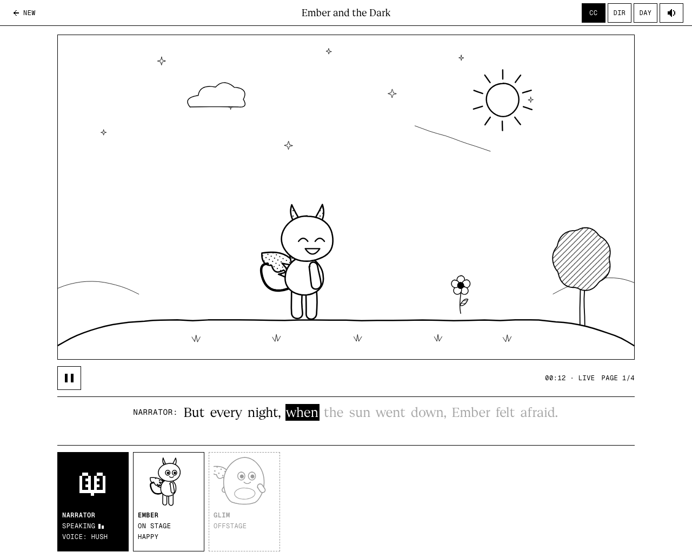
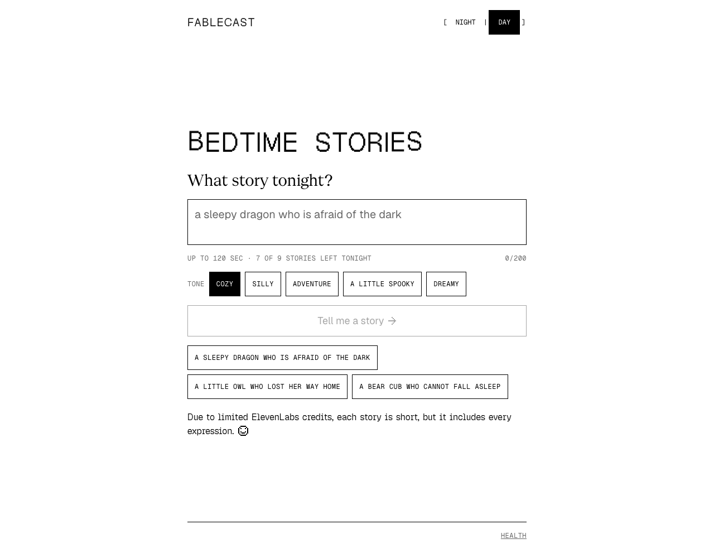
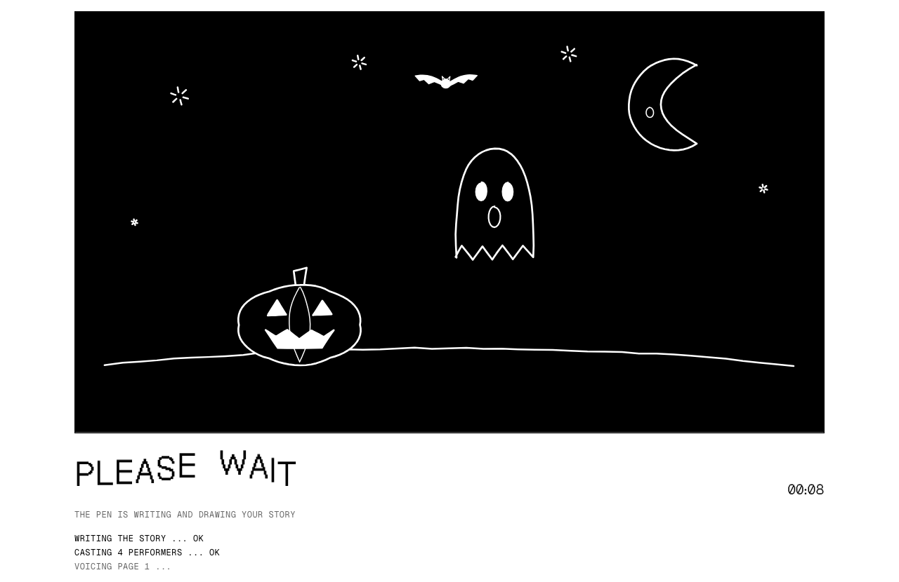
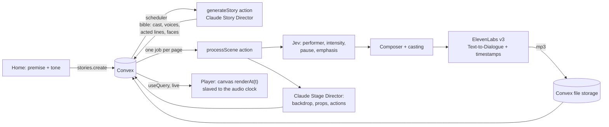
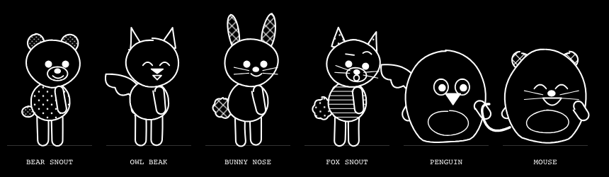

# Fablecast

**A bedtime story that draws itself while it is told.**

Type a premise, pick a tone, and Fablecast writes a brand-new story, casts a troupe of voices, and *performs* it live:
a pen sketches every page stroke by stroke, the characters walk on and react, and the words light up as they are spoken.

**Live:** [fablecast.vercel.app](https://fablecast.vercel.app) · Built in one night at **Night Hack** (Founders, Inc., San Francisco, Oct 30 2026)




---

## What it does

1. **You ask.** "A baby bear and a wise old owl look for the lost moon on Halloween." Pick a tone: Cozy, Silly, Adventure, A Little Spooky or Dreamy.
2. **It writes.** Claude writes a small, sensible story (one hero, one small problem, a kind ending, a cozy goodnight), casts the characters and decides how every line should be *acted*.
3. **It draws, live.** Page 1 starts in about 20 seconds while the later pages are still being made. The pen sketches the backdrop, the props and each character part by part; then they walk, wave, jump, hide, shiver and change expression with the story.
4. **It performs.** A storyteller narrator and a voice for every character read it aloud, with real emotion, pace and timing. Captions show who is talking (`NARRATOR:` / `BRAMBLE:`) and highlight each word as it is spoken.
5. **The child plays.** Tap a character to make it jump, tap a pumpkin to make it pop. When the story ends, rewind and watch it again.

| Home | While the story is written |
|---|---|
|  |  |

---

## Not your everyday text-to-speech

Most "AI story" apps paste text into a TTS box and get one flat voice. Fablecast treats every story as a **performance** that is
written, directed, cast and acted, line by line.

**1. Claude writes the acting, not just the words.** For every line, Claude also writes a *performed* version with ElevenLabs v3
audio tags where the feeling changes, timing punctuation and one emphasised word:

```text
NARRATOR  [warmly] On Halloween night, little Bramble the bear looked up.
BRAMBLE   [gasps] Oh no! [worried] The moon is GONE!
OLD HOOT  [curious] Hoo, hoo. [warmly] Let's find it together, little one.
```

**2. Every emotion, in every story.** Each story is required to use all seven faces (neutral, happy, curious, worried, scared,
sleepy, proud) and the full voice range: laughs, giggles, whispers, gasps, sighs, excitement, curiosity, nerves and yawns.
The face a character shows on the page matches the line being spoken.

**3. A tone you choose.** The tone shapes both the story and the delivery:

| Tone | The story | The pace | Voice colours |
|---|---|---|---|
| Cozy | small comforts, kind friends | mid pace, brighter for fun bits | softly, warmly, chuckles |
| Silly | mix-ups, funny sounds | brisk and bouncy, comic timing | giggles, laughs, mischievously |
| Adventure | a brave little quest | fast and punchy in the action | excited, breathless, cheering |
| A Little Spooky | creaks that turn out friendly | one whispery build-up, quick reveals | whispers, gasps, trembling |
| Dreamy | clouds, stars, drifting off | calm and flowing | dreamily, sleepily, yawns |

**4. Pace that follows the story.** Mostly a lively mid pace, with fast moments for excitement and at most three slow moments,
saved for where the story truly needs them. That cap is enforced in code, not just requested. Playback runs slightly faster
with pitch preserved.

**5. A real cast.** The narrator is Lily, a warm British storyteller. Every character gets its own voice matched to its
gender and age (a grandpa sounds like a grandpa, a little girl like a little girl) and speaks its own dialogue.

**6. A director for every line.** [Jev](https://docs.typesafe.ai) decides, in milliseconds, which mood performer each line
belongs to, how intense it is, whether it pauses, and whether it earns a hand-drawn highlight. Its calibrated probabilities are
visible in **Director's View** (`DIR`).

**7. Perfect sync, or nothing.** An acted line is used only if it speaks *exactly* the caption's words, so the word timings
ElevenLabs returns map one-to-one onto the captions and the drawings. All audio is ElevenLabs: there is no robotic browser voice
fallback. If ElevenLabs is busy, a page waits its turn; if it fails, the page is retried.

---

## How it works



- **Who decides what.** Claude makes *content* (the story, the cast, the acting, the staging). Jev makes *decisions* (per-line
  routing). Code makes *composition and rendering* (tags to voices, timelines, drawing). Claude never writes code for the browser:
  it returns JSON that is validated with Zod and sanitised.
- **Streaming.** Each page is its own Convex job. Voicing starts as soon as Jev has routed a page, in parallel with staging, and the
  player subscribes with `useQuery`, so page 1 plays while pages 2 to 4 are still being made.
- **Audio is the clock.** The player follows the `<audio>` element's own time, and the engine draws the board as a pure function
  of that time: `renderAt(ctx, timeline, t)`. Captions, gestures, entrances and highlights are compiled from ElevenLabs'
  word timestamps, so they land on the words.
- **Live first.** The first telling is live: no scrubbing, no skipping ahead, no spoilers in Director's View. The scrub bar and
  REWIND appear when the story ends.

### The drawing engine

A small, dependency-free Canvas 2D engine in `engine/`:

- **Pen strokes.** Every shape is a polyline drawn on progressively, with seeded hand-drawn wobble, so the same moment always gives
  the same pixels (scrubbing and replay are exact).
- **Characters.** Two hand-made rigs (biped and blob) with seven expressions, a walk cycle, a hop, ten gestures and tap reactions,
  plus species features (ears, snout, beak, button nose, whiskers, wings, horns, tails, accessories). Claude picks features so a bear
  reads as a bear and an owl as an owl.
- **Scenery.** Eight backdrops and 22 hand-drawn props, including a Halloween set (jack-o'-lantern, bat, cobweb, candy, ghost,
  witch hat), plus custom props that Claude draws for each story (a kite, a sandcastle, a teapot), sanitised to safe SVG paths.
- **Black and white only.** Night pages (white on black) and Day pages (black on white); colours are line styles and fill patterns.
  `pnpm check:mono` fails the build on any other colour.
- **Self-checking.** A deterministic lint flags dead air, overlaps, off-board ink and actions on characters that have not entered;
  `pnpm test` fails on any warning.

| Characters | Halloween props |
|---|---|
|  |  |

---

## Stack

| Layer | Choice | Role |
|---|---|---|
| App | **Next.js 16** (App Router), **React 19**, **TypeScript** | Home, live player, Director's View |
| Backend | **[Convex](https://convex.dev)** | Database, actions, scheduler, file storage, realtime queries, durable cache and limits |
| Story and staging | **Claude Sonnet 5.5** (Anthropic API) | Story Director and Stage Director, structured JSON through tool use |
| Line decisions | **Jev 1.14** (TypeSafe AI, direct API) | Per-line performer, intensity, pause, emphasis, with probabilities |
| Voices | **ElevenLabs v3** Text-to-Dialogue with timestamps | Multi-voice acted takes with character-level alignment |
| Rendering | HTML **Canvas 2D**, custom engine | Pen-drawn scenes, rigs, props, captions timing |
| Validation | **Zod** | Every model output is parsed, repaired or replaced |
| Type | **Geist** Sans, Serif, Mono and Pixel | Interface, story text, metadata, display |
| Hosting | **Vercel** (frontend) + **Convex** (backend) | Provider keys live only in Convex |
| Tooling | Playwright, tsx | Contact sheets, determinism and layout tests |

### Convex in detail

| Piece | What it does |
|---|---|
| `stories` table | One row per story: premise, tone, status, and the Story Director's bible |
| `scenes` table | One row per page: status, attempts, the compiled result, and the audio file id |
| `cache` table + file storage | Content-addressed cache of every model call (story, staging, Jev, voice takes) |
| `usage` table | Durable daily counters (stories per night, characters, tokens) shared by every server instance |
| `stories.create` (mutation) | Validates the premise, enforces the nightly limit transactionally, schedules generation |
| `pipeline.generateStory` (action) | Runs the Story Director, stores the bible, fans out one job per page |
| `pipeline.processScene` (action) | Jev routing, staging and ElevenLabs voicing for one page; stores the mp3; retries on failure |
| `stories.get` (query) | What the player subscribes to: the bible plus every finished page, with audio URLs |
| `pipeline.health` (action) | Provider status for `/health`, without exposing keys |

---

## Run it locally

Requirements: Node 20+, pnpm, a Convex account. Keys for Anthropic, TypeSafe (Jev) and ElevenLabs are optional: without them
every provider falls back to a deterministic mock, so the whole app runs for free.

```bash
pnpm install
npx convex dev          # creates your dev deployment and writes .env.local
pnpm dev                # http://localhost:3000
```

Set provider keys on the Convex deployment (they are read by the actions, never by the browser):

```bash
npx convex env set ANTHROPIC_API_KEY sk-ant-...
npx convex env set JEV_API_KEY ...
npx convex env set ELEVENLABS_API_KEY ...
```

| Setting | Default | Meaning |
|---|---|---|
| `DAILY_STORY_RUNS` | `9` | New stories per night, for everyone (resets at 00:00 UTC) |
| `MAX_STORY_SECONDS` | `120` | Hard cap on the whole video, page turns included |
| `NARRATOR_VOICE` | `lily` | `lily`, `brian`, `george`, or any ElevenLabs voice id |
| `VOICE_MODE` | `cast` | `cast` (narrator + character voices), `ensemble` (mood performers), `locked` |
| `VOICE_RATE` | `1.15` | Playback speed, pitch preserved |
| `STORY_MODEL` / `STAGING_MODEL` | `claude-sonnet-5-5` | Claude models for the two directors |
| `JEV_MODEL` | `jev-1.14.0` | Pinned Jev model |
| `MOCK_CLAUDE` / `MOCK_JEV` / `MOCK_AUDIO` | `0` | Force the free mock path for a provider |

The full list, with comments, is in [`.env.example`](.env.example).

### Scripts

| Command | What it does |
|---|---|
| `pnpm dev` / `pnpm build` | Next.js dev server / production build |
| `pnpm test` | Compiles and lints the bundled sample story and mock stories, checks the length and voice budgets, and proves `renderAt(t)` is deterministic; fails on any warning |
| `pnpm check:mono` | Fails on any colour other than black and white |
| `pnpm sheet` | Renders the end of every line into one contact-sheet image (needs `pnpm dev`) |
| `pnpm golden` | Rebuilds the bundled sample story used by the tests |

### Deploy

```bash
npx convex deploy                 # backend to your production deployment
vercel deploy --prod              # frontend; set NEXT_PUBLIC_CONVEX_URL to the production Convex URL
```

---

## Repository map

```text
app/                 Next.js routes: Home, /story/[id], /health, /render/[id] (canvas only), /dev/* previews
components/          Board, Transport, CaptionBar, CastStrip, DirectorDrawer, LoadingBoard, BounceTitle, ...
hooks/usePlayback.ts The single clock, slaved to the scene's <audio>
convex/              Schema, story jobs (mutations, queries) and the pipeline actions
lib/                 Story and Stage Directors, Jev router, composer, casting, ElevenLabs, cache, limits, tones
engine/              Timeline compiler, renderAt, rigs, backdrops, props, primitives, lint
data/                Voice pool and the bundled sample story
tests/               Test runner, composer and length tests
docs/PLAN.md         The original build plan
DECISIONS.md         Every design decision, one line each, in order
```

---

## Built at Night Hack

Fablecast was planned before kickoff ([docs/PLAN.md](docs/PLAN.md)) and built during the event: the drawing engine, rigs, props,
Convex pipeline, Claude directors, Jev routing, ElevenLabs performance, live player and every iteration on voice, pace and
expression. [DECISIONS.md](DECISIONS.md) records each change and why it was made.

**Credits.** Claude (Anthropic), Jev (TypeSafe AI), ElevenLabs, Convex, Vercel, and the Geist type family (SIL Open Font
License 1.1). The pen-drawing approach (the voice drives the clock, strokes ordered within a spoken line, a lint loop that fails
tests) is inspired by the open-source [khan-explainer](https://github.com/haiderfarooq3/khan-explainer) project (MIT); no code was
copied. Fablecast is not affiliated with Khan Academy. See [THIRD_PARTY.md](THIRD_PARTY.md).

**Why stories are short.** ElevenLabs credits are limited, so each story is short, but it still includes every expression.
