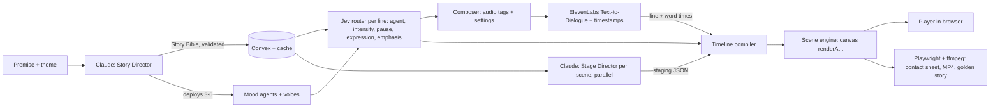

# Fablecast: a living storybook

> A bedtime story that **draws itself while it is told.**
> Claude writes the story and "stages" it. A troupe of mood performers voices it. A pen sketches the scenery and the characters, the characters walk and react, the words appear as captions you can switch on or off, and a child can tap the drawings to make them respond.

Built for **Night Hack by Founders, Inc.** (San Francisco, Oct 30 2026): kickoff 4:15pm, **submissions due 9:00pm** (about 4 hours 45 minutes of building), then **90-second live demos with a two-minute hard stop, no slides**. The demo must run on a **public URL** (never localhost-only).
This document is the **complete plan**. A coding agent should be able to build the product from this file alone.

Items marked 🟡 are **verify-before-relying** (see [section 17](#17-verify-before-relying)).

---

## 0. Instructions to the build agent

1. **Read this whole document before writing code.**
2. Build in the order of [section 15](#15-build-order-and-acceptance-criteria). Do not start a P1 feature until every P0 acceptance test passes.
3. **Priorities, in order:** reliability, then wow, then breadth. A smaller thing that always works beats a bigger thing that sometimes works.
4. Where a decision is not specified, **choose a sensible default and log it** in `DECISIONS.md` (one line each). Do not stop to ask.
5. Where something is marked 🟡, check the current official docs, then log what you found.
6. The reference repo ([khan-explainer](https://github.com/haiderfarooq3/khan-explainer), MIT) is a **design and code reference**, not a dependency. **Read its source before reusing anything** (`scripts/render.js`, `examples/ai-agents.js`, `tests/run.js`). See [section 3](#3-what-we-take-from-khan-explainer) and [section 19](#19-licence-attribution-and-disclosure).
7. The product must be **safe for children**: age-appropriate content only, no accounts, no personal data, no user-supplied code execution.

---

## 1. Product

### 1.1 One-line pitch
**Every night, a new story that is drawn, voiced, and playable, in front of your child.**

### 1.2 Users
- **Primary:** a parent and a child (ages 3-8) at bedtime, on a phone or tablet.
- **Demo audience:** judges at Night Hack, on a laptop and projector.

### 1.3 The experience
1. **Home.** The user types a premise ("a sleepy dragon who is afraid of the dark") or picks a ready-made story. The whole interface is black and white: **Night pages** (white on black) or **Day pages** (black on white).
2. **The book opens within ~15 seconds.** Scene 1 starts while later scenes are still being prepared.
3. **The pen draws the world.** Scenery is sketched stroke by stroke. Each character is drawn part by part, then comes to life and walks onto the stage.
4. **The story is performed.** Different mood performers (each with their own voice) deliver the lines. The words appear in a **caption bar under the board, word by word as they are spoken** (a CC button turns captions on or off). **Every character in the story is shown in a cast strip below the board**, and the one who is on stage or speaking lights up.
5. **Characters act.** They walk, wave, peek, hide, jump, shiver, and change expression with the mood of each line. Key moments get a hand-drawn emphasis mark (a ring, a sparkle, an underline).
6. **Lights change with the story.** When the story says the lights go out, the whole page flips from day to night.
7. **The child can touch things.** Tapping a character makes it react. Tapping a prop makes it wiggle or pop.
8. **Page turns** between scenes, then "The End".
9. **Director's View** (toggle) shows what the system decided, line by line.

### 1.4 Feature list

| ID | Feature | Priority |
|---|---|---|
| F1 | Premise to full illustrated, voiced story (3-6 scenes, length capped by `MAX_STORY_SECONDS`) | **P0** |
| F2 | Mood agents deployed by Claude, each with its own voice | **P0** |
| F3 | Jev decides, per line, which mood agent speaks, how intense, how long a pause | **P0** |
| F4 | Pen-draw scenery and characters (stroke by stroke) | **P0** |
| F5 | Rigged characters that walk, gesture, and show expressions | **P0** |
| F6 | Captions synced to the spoken words, with an on/off (CC) toggle | **P0** |
| F7 | Audio-clock playback: pause, replay, scrub | **P0** |
| F8 | Content-addressed cache, retries, fallbacks, offline golden story | **P0** |
| F9 | Tap interactions on characters and props | **P1** |
| F10 | Day and night themes, flipping mid-story on a "lights" action | **P1** |
| F11 | Emphasis marks (ring, sparkle, underline) on key moments | **P1** |
| F12 | Director's View (agents, probabilities, latency, cache hits, lint warnings) | **P1** |
| F13 | Layout lint (deterministic WARN checks) and contact sheet | **P1** |
| F14 | Local MP4 export of a story (Playwright + ffmpeg) | **P1** |
| F15 | Multi-language stories and right-to-left captions | P2 |
| F16 | Drag props, pen-nib sprite, chalk texture | P2 |
| F17 | Black-and-white interface in the Geist type family (Pixel, Serif, Sans, Mono) | **P0** |
| F18 | Cast strip under the board: every character, live on-stage and speaking state, tap to react | **P0** |
| F19 | Story-length and session time limits controlled from `.env` | **P0** |

### 1.5 Non-goals
Accounts, payments, parent-voice cloning, AI-generated photoreal images or video clips, Genie or other interactive world models (no public API), lip-sync, copyrighted stories (use public-domain tales and original stories only).

---

## 2. How it works



### Who decides what

| Step | Owner | Why |
|---|---|---|
| Story, characters, mood agents, voice traits | **Claude (Story Director)** | Creative; needs whole-story context |
| Scenery choice, props, per-line actions (who walks where, gestures, lights) | **Claude (Stage Director)** | Needs the lines of one scene; runs in parallel per scene |
| Which agent speaks each line | **Jev** | Fast, typed, calibrated; the "speaker by mood" decision |
| Intensity, pause, expression, emphasis | **Jev** | Same request as the speaker decision |
| Audio tags and voice settings from decisions | **TypeScript** | Deterministic and testable |
| Voices and audio, plus word times | **ElevenLabs** (v3, Text-to-Dialogue) | Expressive, multi-voice, timestamps |
| Everything drawn on screen | **Scene engine (canvas)** | A pure function of audio time |
| Jobs, storage, realtime, cache | **Convex** | Scene 1 plays while others prepare |

**Design rule:** Jev makes *decisions*, Claude makes *content*, code makes *composition and rendering*. Thresholds and side effects live in our code. **Claude never writes executable code for the browser.** It outputs validated JSON only.

---

## 3. What we take from khan-explainer

Reference: https://github.com/haiderfarooq3/khan-explainer (MIT). It is a macOS Claude Code skill that renders "a pen draws while a voice explains" videos from a scene file, using an HTML canvas, Playwright, ffmpeg, and a local voice.

| khan-explainer feature | How Fablecast uses it |
|---|---|
| **The voice drives the clock.** A scene is a list of *beats* (one spoken clause plus the drawing during it); the renderer measures the speech and fits the drawing to it. Nobody types timestamps. | Audio is the master clock. Our beats are **lines**. ElevenLabs alignment gives each line's and word's real start and end times, and all animation is derived from them. |
| **`p` runs 0 to 1 while a beat is spoken**, and `seg(p, from, to)` orders strokes inside a beat. | Every action and drawing is evaluated from `p`. `seg` orders strokes within a line (for example: ring appears when the keyword is spoken). |
| **Drawing primitives:** `write`, `stroke`, `arrow`, `check`, `line`, `curve`, `oval`, `box`, `ring`, `around`, `view`, `seg`, and a named chalk palette. | Re-implemented in `engine/primitives.ts` with the same names and semantics (see section 6.3). |
| **Chalk on blackboard / marker on whiteboard**, one flag switches, a single beat can flip the board mid-video. | Night pages and Day pages, and a `lights` action that flips the theme from that moment on. |
| **Contact sheet:** the board at the end of every beat in one image, plus every beat full-size, and `WARN` for text off the board or labels overlapping. Claude checks its own layout before showing anything. | `pnpm sheet` renders the end of every line with Playwright, and `engine/lint.ts` emits WARNs (section 6.11). Build agents must read the sheet before declaring a phase done. |
| **Pace formulas** (`words / 3 + beats * 0.15 + 1.3`), "to hit a target, change the words, not the rate". | The Story Director gets a **word budget** from target length. We calibrate real words per second after the first take. |
| **Take caching** (`.voice/`), and "lay out the board with the free voice first, then switch the human voice on and change only drawings". | Content-addressed cache everywhere, and a **draft voice mode** so staging work never burns credits (section 9.3). |
| **ElevenLabs path:** read the whole script in one take, cut it back into beats at the returned character times. | Same idea, using Text-to-Dialogue per scene for multiple voices. |
| **Free local voices:** macOS `say`, Kokoro (local, human-sounding). | Used only for **local development and offline pre-render**, never as a hosted dependency. |
| **Taste rules:** one colour per concept; exaggerate scale; draw what is being said as it is said; every beat adds something new (a beat that redraws the last mark is dead air); clear the board when full. | **One ink token per mood agent** (in the default monochrome mode each token maps to a distinct line style); key objects drawn large; **every line must change something visible**; each scene is a page that clears at the turn. |
| **Tests:** `node tests/run.js` renders every example and fails on any warning. | `pnpm test` compiles and lints the golden story and sample premises and fails on any WARN. |
| **Multilingual writing** (right-to-left, per-script faces). | P2 only (section 1.4). |

**Not adopted** (macOS-only or out of scope): macOS `say` and Vision as hosted dependencies, the draw-over-UI tutorial mode, YouTube and podcast clip cutting, faster-whisper, yt-dlp, and the talking-head cutout.

---

## 4. Tech stack

### 4.1 Adopted from khan-explainer

| Layer | Choice | Notes |
|---|---|---|
| Runtime | **Node.js 20+** | Same requirement as the reference |
| Renderer | **HTML5 Canvas 2D** | Deterministic `renderAt(t)`; same engine runs in the browser and in headless Chromium |
| Headless capture | **Playwright + Chromium** | Contact sheet, MP4 frames, tests |
| Video encode | **ffmpeg** | Local only (`brew install ffmpeg` or `apt install ffmpeg`) |
| Human voice | **ElevenLabs** (v3) with character-level timing, takes cached | Hosted production voice |
| Free local voice (dev only) | **Kokoro** (Python) or macOS `say` | Local draft and pre-render only |
| Drawing primitives and semantics | `write`, `stroke`, `arrow`, `check`, `ring`, `around`, `seg`, palette | Ported to TypeScript |
| QA loop | Contact sheet + WARN lint + tests that fail on WARN | Ported |

### 4.2 Added for the web product

| Layer | Choice |
|---|---|
| Language | **TypeScript** (the reference is JavaScript) |
| App | **Next.js (App Router) + React** |
| Backend, realtime, storage, cache | **Convex** |
| Story and staging LLM | **Anthropic API (Claude)**; configurable models |
| Decision model | **Jev** (TypeSafe AI), called **directly** (`POST https://api.typesafe.ai/v1/systemone`, key `JEV_API_KEY`); no Vercel AI Gateway |
| Validation | **Zod** |
| Hosting | **Vercel** |
| Fonts | **Geist** (Sans, Serif, Mono, Pixel) from the `geist` npm package, loaded through `next/font`, so headless renders never depend on the network (see section 12.2) |

### 4.3 Prerequisites
Node 20+, pnpm, ffmpeg (local scripts only), Playwright Chromium (`pnpm exec playwright install chromium`), accounts and keys for Anthropic, TypeSafe AI (Jev, direct API), ElevenLabs, Convex.

**Platform note:** do **not** depend on macOS-only components. The app and scripts must run on macOS and Linux.

---

## 5. Data contracts (Zod)

```ts
// lib/schemas.ts
import { z } from "zod";

export const ColorName = z.enum(["yellow","blue","orange","pink","green","red","purple","white"]);
export const Pos = z.tuple([z.number().min(0).max(1), z.number().min(0).max(1)]); // normalised stage coords

// ---- Mood agents (deployed by Claude per story) ----
export const MoodAgent = z.object({
  id: z.string().regex(/^[a-z][a-z0-9_]*$/),          // Jev choice key
  name: z.string(),                                    // "Hush"
  mood: z.string(),                                    // "calm, warm, near-whisper"
  routingHints: z.array(z.string()).min(2).max(5),     // criteria text for Jev
  voiceTraits: z.object({
    age: z.enum(["child","adult","elder"]),
    gender: z.enum(["female","male","neutral"]),
    quality: z.string(),                               // "soft, breathy"
  }),
  tagPalette: z.tuple([z.array(z.string()), z.array(z.string()), z.array(z.string())]), // v3 tags by intensity [calm, clear, peak]
  voiceSettings: z.object({ stability: z.number().min(0).max(1), style: z.number().min(0).max(1) }),
  ink: ColorName,                                      // ONE ink token per mood: emphasis marks and line style (a hue in chalk mode, a line style in mono mode)
  wobble: z.number().min(0).max(1.5),                  // line shakiness; scared moods wobble more
});

// ---- Characters (skins on top of hand-made rigs) ----
export const CharacterSkin = z.object({
  id: z.string(),
  name: z.string(),
  rig: z.enum(["biped","blob"]),                       // "quadruped" is P2
  palette: z.object({ body: ColorName, accent: ColorName, outline: ColorName }),
  features: z.object({
    ears: z.enum(["none","round","pointy","long"]).default("none"),
    tail: z.enum(["none","short","long","fluffy"]).default("none"),
    horns: z.boolean().default(false),
    wings: z.boolean().default(false),
    spikes: z.boolean().default(false),
    eyes: z.enum(["dots","round","sleepy"]).default("dots"),
    accessory: z.enum(["none","scarf","hat","cape","glasses"]).default("none"),
  }),
  scale: z.number().min(0.6).max(1.6).default(1),
});

// ---- Story ----
export const Line = z.object({
  character: z.string(),            // character id or "narrator": WHO the line is about (visuals); the speaker voice is chosen by Jev
  text: z.string(),                 // one spoken clause
  focus: z.string().optional(),     // id of a character or prop the line draws attention to
  keyword: z.string().optional(),   // a word in `text` when emphasis should land
});

export const Scene = z.object({
  id: z.number(),
  summary: z.string(),
  mood: z.string(),
  lines: z.array(Line).min(2).max(6),
});

export const StoryBible = z.object({
  title: z.string(),
  worldNote: z.string(),                               // setting, time of day, tone
  characters: z.array(CharacterSkin).min(1).max(4),
  agents: z.array(MoodAgent).min(3).max(6),
  scenes: z.array(Scene).min(3).max(6),
  startLights: z.enum(["night","day"]),
});

// ---- Stage Director output (one call per scene) ----
export const PenPath = z.object({
  d: z.string().max(600),                              // SVG path, ONLY M L C Q Z (absolute), in a 0..100 local box
  color: ColorName.optional(),
  width: z.number().min(1).max(8).optional(),
});

export const Prop = z.object({
  id: z.string(),
  preset: z.enum(["moon","star","tree","house","cave","bed","lantern","rock","cloud","flower","door","hill","box","bush","sun","window"]).optional(),
  custom: z.array(PenPath).max(6).optional(),          // used when no preset fits
  at: Pos, size: z.number().min(0.05).max(0.6),
  tappable: z.boolean().default(true),
  reaction: z.enum(["wiggle","pop","glow"]).default("wiggle"),
});

export const Action = z.discriminatedUnion("type", [
  z.object({ type: z.literal("enter"), who: z.string(), from: z.enum(["left","right","top","bottom"]), to: Pos }),
  z.object({ type: z.literal("walk_to"), who: z.string(), to: Pos }),
  z.object({ type: z.literal("face"), who: z.string(), dir: z.enum(["left","right"]) }),
  z.object({ type: z.literal("look_at"), who: z.string(), target: z.string() }),
  z.object({ type: z.literal("gesture"), who: z.string(),
             kind: z.enum(["wave","point","jump","shrug","hug","hide","peek","spin","sleep","shiver"]) }),
  z.object({ type: z.literal("exit"), who: z.string(), to: z.enum(["left","right","top","bottom"]) }),
  z.object({ type: z.literal("prop"), id: z.string(), do: z.enum(["appear","disappear","move"]), to: Pos.optional() }),
  z.object({ type: z.literal("camera"), focus: Pos, zoom: z.number().min(1).max(1.4) }),
  z.object({ type: z.literal("lights"), mode: z.enum(["night","day"]) }),
]);

export const TimedAction = z.object({
  line: z.number().int().min(0),                       // line index within the scene
  at: z.number().min(0).max(1),                        // where in the line the action starts
  span: z.number().min(0.1).max(1).default(1),         // how much of the line it lasts
  action: Action,
});

export const SceneStaging = z.object({
  sceneId: z.number(),
  backdrop: z.enum(["night_forest","cave","bedroom","meadow","seaside","village","sky","hilltop"]),
  props: z.array(Prop).max(8),
  actions: z.array(TimedAction).max(30),
});

// ---- Jev decisions (per line) ----
export const Expression = z.enum(["neutral","happy","curious","worried","scared","sleepy","proud"]);
export const LineDecision = z.object({
  agentId: z.string(),
  intensity: z.union([z.literal(0), z.literal(1), z.literal(2)]),
  pause: z.enum(["none","short","long"]),
  expression: Expression,
  emphasis: z.boolean(),
  probabilities: z.record(z.number()).optional(),      // for Director's View
  latencyMs: z.number(),
  cacheHit: z.boolean(),
});
```

**Sanitising Claude's output (mandatory):** all `PenPath.d` strings pass `engine/sanitize.ts`: only the commands `M L C Q Z`, numeric tokens only, coordinates clamped to the local box, max 40 segments per path. Anything invalid is dropped, and the scene falls back to the preset scenery. **A scene must never fail to render.**

---

## 6. Scene engine (`engine/`)

### 6.1 Principles
1. **Audio is the master clock.** The player calls `renderAt(ctx, timeline, audio.currentTime)` every animation frame.
2. **`renderAt(t)` is a pure function of `t`** (plus the timeline). No hidden accumulating state. That makes pause, replay, scrubbing, headless capture, and the golden-story MP4 all trivially correct, and it is how the reference stays in sync.
3. **Timeline compile step:** `compile(storyBible, stagingByScene, decisions, alignment) -> Timeline` converts every relative time into absolute seconds using ElevenLabs line and word times.
4. **Determinism:** hand-drawn wobble uses a seeded noise function keyed by path id, so a frame is identical every time it is drawn.
5. **Interaction effects** (taps) are layered on top using wall-clock time and never alter the timeline.

### 6.2 Board, units, and themes
- Board is **1280x720** (landscape, 16:9) or **720x960** (portrait, 3:4), chosen from the viewport aspect. All stage positions are **normalised 0..1** and mapped to the board with safe margins (landscape: 60; portrait: 40).
- The whole board is stage. **Captions live outside the board** (sections 6.8 and 12.3). Leave a 12% ground band at the bottom for the ground line and feet.
- **Themes:** `night` = white ink on a black board, `day` = black ink on a white board. Colour **tokens** (`yellow`, `blue`, ...) are semantic names, not literal hues. With `INK_MODE=mono` (default) each token resolves to a **line style and fill pattern** (section 12.4); with `INK_MODE=chalk` it resolves to a hue. Resolve tokens at draw time, never cache them across a theme flip.
- A `lights` action flips the theme from its time onward. Ink already on the page inverts with it.

### 6.3 Primitives (ported from the reference, same names)

| Call | Behaviour |
|---|---|
| `write(str, x, y, p, {size, color, center})` | Pen-writing reveal of text, letter by letter, in Geist Pixel; used **only** for page titles and "THE END"; `y` is the baseline |
| `stroke(points, p, {color, width})` | Draw a polyline progressively up to fraction `p` |
| `arrow(from, to, p, {color, ctrl})` | Arrow, optionally bent by a control point |
| `check(x, y, p, {size, color})` | Tick mark |
| `line` `curve` `oval` `box` | Return point lists for `stroke` |
| `ring(rect, pad)` `around(rect, pad)` | Oval or frame around a `{x,y,w,h}` rectangle |
| `seg(p, from, to)` | A slice of the line's `p`, to order strokes |
| `C.yellow` ... `C.white` | Colour names resolved per theme at draw time |

Text width estimate for layout: about `0.45 * size` per character (normal label), `0.63 * size` per capital.

### 6.4 The pen-drawn look
- Every path is **flattened to a polyline once** (sample the SVG path via a hidden `SVGPathElement` using `getTotalLength` and `getPointAtLength`; cache the result).
- Add **seeded jitter** to the sampled points (amplitude from the speaker agent's `wobble` and a small base), slight width variation, round caps and joins.
- **Draw-on** = draw the first `p * totalLength` of the polyline. No dash tricks needed.
- Parts and paths draw in a fixed order so a character appears to be sketched head, body, limbs, then face.
- P2: chalk texture (a second faint offset pass), pen-nib sprite at the drawing head.
- Respect `prefers-reduced-motion`: no jitter, no camera moves.

### 6.5 Characters: rigs, expressions, motion
**Rigs are hand-made code assets** (not generated at runtime): `engine/rigs/biped.ts` and `engine/rigs/blob.ts`.

- **Biped parts (named, with pivots):** `head`, `body`, `armL`, `armR`, `legL`, `legR`, plus optional `tail`, `ears`, `horns`, `wings`, `spikes`, `accessory`, and a `face` layer (eyes, brows, mouth).
- **Blob:** one body shape plus eyes, mouth, and optional stub arms. Locomotion is a **hop** (squash and stretch).
- A skin (`CharacterSkin`) selects colours and feature variants; it never supplies geometry.
- **Entrance:** the pen **draws the character on** part by part (progress by part order), then it is alive.
- **Walk cycle (biped):** legs swing about +/-25 degrees, arms counter-swing about +/-20 degrees, body bob about 4% of height, cycle driven by distance travelled. Idle: slow breathing scale. Speed comes from distance divided by the action's duration, clamped to a sensible range.
- **Expressions** (from Jev): each of the seven has a face variant and a posture offset. For example: `sleepy` droops the head and half-closes the eyes, `happy` adds a small bounce, `scared` adds a fast low-amplitude tremble, `worried` tilts the brows and lowers the shoulders, `proud` lifts the chin.
- **Gestures:** `wave`, `point`, `jump`, `shrug`, `hug`, `hide` (duck behind the nearest prop or below the ground line), `peek`, `spin`, `sleep`, `shiver`. Each is a short keyframed animation on named parts.
- Characters have a facing direction; moving left or right flips them.

### 6.6 Scenery and props
- **Backdrops are hand-made presets** (`night_forest`, `cave`, `bedroom`, `meadow`, `seaside`, `village`, `sky`, `hilltop`), each a small set of strokes: ground line, silhouettes, sky elements. They draw on at the start of a scene (the "page").
- **Props** are presets (`moon`, `tree`, `house`, ... see the schema) or up to six custom paths from Claude (sanitised, local 0..100 box). Props can appear, disappear, and move via `prop` actions and can be `tappable`.
- Keep geometry simple. The sketch style hides imperfections, and **simple silhouettes are a feature.**

### 6.7 Action vocabulary and timing
Claude's `TimedAction`s are **relative to a line**: `at` (0..1) and `span` (0..1). The compiler multiplies by the line's real start and duration. Actions that need duration (`walk_to`, `enter`, gestures) get `span * lineDuration`, with minimums so nothing is instantaneous.

If two actions conflict on one character, the later one wins and lint emits a WARN.

### 6.8 Captions (toggle on or off)
- Captions are **not drawn on the board.** In the live player they appear in the **caption bar** below the board (DOM text, Geist Serif): spoken words at full opacity, upcoming words dimmed, and the current word highlighted (section 12.3). The `CC` button toggles them, and the choice persists.
- Word timing comes from the alignment's **word start and end times**. `engine/captions.ts` exposes `activeWordAt(t)` and a line-wrapping function shared by the DOM caption bar and MP4 export (export burns captions onto each frame in Geist Serif when `--captions` is passed).
- Show at most two lines; the previous line fades out when the next begins.
- A visually hidden `aria-live` mirror always carries the text, even when captions are off.
- Text drawn on the board itself is limited to Geist Pixel page titles ("PAGE 2") and "THE END".

### 6.9 Emphasis marks
When Jev says `emphasis: true` for a line:
- If the line has a `focus` target, draw a hand-drawn **ring or frame** (`ring` or `around`) on that character or prop, timed to the `keyword`'s spoken time via `seg`, coloured with the speaker's `ink`.
- Otherwise (only when captions are on) underline the keyword in the caption bar.
- Maximum one emphasis mark per line. A small sparkle burst (a few short strokes) may be used for happy or proud moments.

### 6.10 Interaction (P1)
- Hit-testing with bounding boxes and `Path2D.isPointInPath` for props and characters; works with touch and mouse.
- Tap a character: a short **reaction** (jump plus a happy face for about 1 second). Tap a prop: its configured `reaction` (`wiggle`, `pop`, `glow`).
- Interactions never change narration or the timeline and are not included in MP4 export.
- P2: drag props.

### 6.11 Lint and contact sheet (the reference's self-check loop)
`engine/lint.ts` runs at compile time and emits `WARN`s, which the engine **auto-corrects where safe** (clamp into bounds) and always logs:
- ink or text off the board or outside safe margins
- caption text that would not fit the caption bar in two lines
- two labels or characters overlapping heavily
- a character exiting without having entered, or acting after it exited
- conflicting actions on one character
- a line with **no visible change** (dead air), or a scene longer than N seconds with no new ink

`pnpm sheet <storyId>` (Playwright) renders the **end of every line** into one contact-sheet image and writes each line full-size as `b000.jpg`, `b001.jpg`, and so on. **Open the sheet and check it before declaring any phase complete.**

---

## 7. Claude calls

Models are configurable: `STORY_MODEL` and `STAGING_MODEL` (default `claude-sonnet-5-5`; a smaller model such as `claude-haiku-5-5` may be used for staging if quality holds). Use structured output (a JSON schema or a tool), parse with Zod, and on failure **retry once** with the validation error attached. If it still fails, use a deterministic default (see below).

### 7.1 Story Director (one call per story)
Produces `StoryBible`: title, world note, characters (skins), **mood agents**, scenes with lines, starting lights.

Rules to put in the prompt:
- **Length:** aim for `TARGET_SECONDS` and never exceed `MAX_STORY_SECONDS` (section 9.2), converted to a **word budget** via `WORDS_PER_SECOND` (start at ~2.5 for a calm bedtime pace, then **calibrate** after the first real take). One spoken **clause per line**, split at punctuation. 3-6 scenes, 2-6 lines each.
- **Tone:** plain words, short clauses, tutor-like warmth ("so", "now", "let's say"). No term the child has not met yet.
- **Safety:** age 3-8, gentle, no violence, only mild "bump in the night" tension, always a comforting ending.
- **Mood agents:** 3-6, each distinct (for example calm, curious, fearful, relieved), each with routing hints, voice traits, a tag palette by intensity, **one ink token per mood** (never reuse a token for two moods, because in mono mode each token is a distinct line style), and a wobble value.
- **Characters:** at most 4, each using a rig (`biped` or `blob`) and a skin. Prefer animals and creatures (they read well as simple line drawings).
- **Original or public-domain stories only.**
- **Visual thinking:** each scene should contain at least two things worth drawing, and key objects should be **big and obvious** (exaggerate scale).

### 7.2 Stage Director (one call per scene, run in parallel)
Input: the scene's lines, the characters, the world note. Output: `SceneStaging`.

Rules:
- Pick **one backdrop preset** and up to 8 props (presets first, custom paths only when nothing fits).
- Every line must **change something visible**: an action, a prop, a camera move, or lights. A line with no visible change is dead air.
- Characters must `enter` before they act and may `exit` after. Keep them inside the stage zone and spread across it (do not stack characters on one spot).
- Only reference ids that exist (characters, props).
- Use `lights` only when the story says the light changes.
- Use `camera` sparingly (at most two moves per scene, zoom at most 1.4).
- Keep path data simple (a handful of curves).

**Fallback when staging fails or is rejected:** a default staging that uses the scene's mood to pick a backdrop, enters each speaking character, and applies idle gestures. **The story always plays.**

---

## 8. Mood agents, Jev routing, composer, voices

### 8.1 Jev routing (the speaker decision)
One request per line, run in parallel (for example 8 at a time). All questions are answered against the same state in a single call.

Jev is called **directly** on the TypeSafe API (no Vercel AI Gateway): `POST https://api.typesafe.ai/v1/systemone` with `Authorization: Bearer ${JEV_API_KEY}` and body `{ model, state, questions }`. Question types on the wire are `choice`, `score`, and `noul` (boolean). Answers come back as `answers[id].choice` + `probabilities` + `confidence`, `answers[id].score` (0..levels-1) + `probabilities`, and `answers[id].noul` (P(true)); the top-level `model` is the resolved version. The shape below is the logical request (implemented in `lib/router.ts` with plain `fetch`):

```ts
const t0 = performance.now();
const result = await jev({                    // lib/router.ts: fetch("https://api.typesafe.ai/v1/systemone")
  model: process.env.JEV_MODEL!,             // pinned direct ID, e.g. "jev-1.14.0"
  state: { sceneSummary, sceneMood, previousLine, character, line: text },
  questions: {
    agent: {                                  // = the SPEAKER for this line
      type: "choice",
      instructions: "Which mood performer should speak this line?",
      criteria: Object.fromEntries(agents.map(a => [a.id, a.routingHints])),
    },
    intensity: { type: "score", instructions: "How emotionally intense is this line?",
      criteria: ["Calm, background narration", "Clear emotion", "Peak moment of the scene"] },
    pause: { type: "choice", instructions: "How long should the performance pause after this line?",
      criteria: { none: ["Flows straight into the next line"], short: ["A natural beat"],
                  long: ["A dramatic beat or the end of the scene"] } },
    expression: { type: "choice", instructions: "What expression does the character show during this line?",
      criteria: { neutral: ["Calm, plain"], happy: ["Joy, laughter"], curious: ["Wonder, questions"],
                  worried: ["Unsure, anxious"], scared: ["Frightened"], sleepy: ["Tired, drowsy"],
                  proud: ["Brave, accomplished"] } },
    emphasis: { type: "noul",
      instructions: "Is this a key moment that deserves a hand-drawn highlight?" },
  },
});
const latencyMs = Math.round(performance.now() - t0);
```

- `agentId` = the chosen agent if its top probability is at least `AGENT_FLOOR` (default 0.40), otherwise the default narrator agent. **No Claude escalation.** Claude is used only as a fallback if Jev errors or is rate-limited.
- The `intensity` score is fractional in `0..2` (three levels); round it to 0, 1, or 2. `emphasis` is true when `noul` (P(true)) is at least 0.5.
- Scores and probabilities are rounded to two decimals; `confidence` is on each Choice and Score answer (`answers[id].confidence`).
- **Pin the model**: `JEV_MODEL=jev-1.14.0` (direct IDs include `jev-1.13.0` and `jev-1.14.0`; `jev-latest` can move). Log the resolved model ID (response `model`) on every run.
- **Fallback chain:** Jev, then a Claude tagging call, then a default decision (`narrator_default`, intensity 1, pause short, expression neutral, emphasis false).

### 8.2 Voice modes
- `VOICE_MODE=ensemble` (default): the chosen agent's voice speaks the line, so the troupe is the cast.
- `VOICE_MODE=locked`: each *character's* cast voice speaks it, and agents only contribute tags and settings. Use this if a character changing voice by mood confuses listeners. Switching is a config change.

### 8.3 Composer
Pure function `(line, agent, intensity, pause) -> performed text + voice settings`:
1. Pick tags from `agent.tagPalette[intensity]`, at most **2 tags per line**.
2. Apply `pause` using pause tags or punctuation (`...`, em-dash). 🟡 v3 pause tags may not exist; punctuation is the fallback.
3. Keep both the performed text (with tags) and the display text (tags stripped).
Unit-test with 10 hand-written lines.

### 8.4 Voice pool and casting
`data/voices.json`: 6-8 ElevenLabs voices tagged by traits (narrator, child_f, child_m, adult_f, adult_m, elder, creature). Casting is deterministic: score each pool voice against an agent's `voiceTraits`, assign the best unused one, and keep it for the whole story. `narrator_default` always uses the narrator slot.

---

## 9. Audio

### 9.1 ElevenLabs Text-to-Dialogue with timestamps (one call per scene)

```
POST https://api.elevenlabs.io/v1/text-to-dialogue/with-timestamps
{ "model_id": "eleven_v3",
  "inputs": [ { "text": "[softly] Once there was a dragon...", "voice_id": "<Hush>" },
              { "text": "[nervous] It's so dark in here!",     "voice_id": "<Shiver>" } ] }
```

🟡 Confirm the exact request shape. The response includes base64 audio, character-level `alignment`, and `voice_segments`.
- **Word times:** group characters into words by whitespace, **ignoring characters inside `[...]`**. A word starts at its first character's start and ends at its last character's end. Line times come from the voice segments.
- Keep each call under the per-call character limit (v3 allows about 5,000; stay far below).
- Store the audio in Convex file storage.

### 9.2 Pace and length
Estimate duration with the reference's formula for planning (`words / words-per-second + lines * gap + about 1.3`) and **replace it with measured times** after the first real take. To hit a target length, change the words, never the speed.

**Time limits (set by you in `.env.local`, enforced on the server, not only in the UI):**
- `MAX_STORY_SECONDS` is the **hard ceiling** on story length (default 120). The Story Director gets a word budget of `MAX_STORY_SECONDS * WORDS_PER_SECOND`, and `TARGET_SECONDS` (default 90, must not exceed the maximum) is what it aims for.
- **Validation:** if a returned `StoryBible` is more than 10% over budget, retry once with a stricter instruction; if it is still over, **trim** lines from the middle scenes (never the first scene or the final comforting scene) until it fits, and log the trim.
- **After the real audio take:** if measured audio still exceeds the ceiling, drop the least important lines (never the final scene), re-voice only the affected scenes (the cache keeps the rest), and log `OVER_LIMIT`.
- `MAX_GENERATION_SECONDS` (default 45) is the longest a user waits for page 1. If scene 0 is not ready by then, show the fallback screen and offer the golden story.
- `MAX_SESSION_MINUTES` (default 30) and `MAX_STORIES_PER_SESSION` (default 5) cap how much one browser session can generate; the UI shows the remaining allowance in Geist Mono.
- The UI reads the ceiling through `NEXT_PUBLIC_MAX_STORY_SECONDS`, mapped from the same variable in `next.config` so there is only one value to edit.

### 9.3 Draft voice mode (do all staging work without spending credits)
`VOICE_PROVIDER=draft|eleven`:
- **draft:** no ElevenLabs calls. Line and word times are **estimated** from word counts (`WORDS_PER_SECOND`), audio is silent (or the browser's `speechSynthesis` for a rough listen). Use it to build and tune the whole staging system.
- **eleven:** real audio and real timings.
Workflow: lay out the page in draft mode, then switch the voice on and change only the drawings.
Local dev can optionally use **Kokoro** or **macOS `say`** through `scripts/` to produce a free draft take with real durations.

### 9.4 Audio fallbacks
Dialogue endpoint, then single-voice TTS with timestamps, then **cached audio**, then draft mode with a small "voice offline" notice. The story never stops.

---

## 10. Convex data model and pipeline

| Table | Key fields |
|---|---|
| `stories` | `premise`, `theme`, `status`, `bible`, `createdAt` |
| `scenes` | `storyId`, `index`, `status` (`queued`, `routing`, `voicing`, `staging`, `ready`, `failed`), `audioStorageId`, `alignment`, `performedLines`, `staging`, `timeline` |
| `routings` | `sceneId`, `lineIndex`, `decision` (see `LineDecision`) |
| `cache` | `key`, `kind`, `payload` or `storageId`, `bytes`, `hits`, `lastHitAt`, `createdAt` |
| `inflight` | `key`, `claimedBy`, `expiresAt` (single-flight lock) |
| `events` | `storyId`, `stage`, `provider`, `ms`, `ok`, `error?` |
| `metrics` | `storyId`, `jevCalls`, `jevMsTotal`, `elevenChars`, `claudeTokens`, `cacheHits`, `resolvedJevModel`, `lintWarnings` |

**Pipeline (streaming):**
1. `generateStory(premise)`: Story Director, validate, store, then fan out `processScene` for every scene (scene 0 first).
2. `processScene(storyId, i)`:
   - in parallel: **Jev routing for each line**, then compose, then **ElevenLabs dialogue**; and the **Stage Director** call;
   - when both finish: **compile the timeline**, run lint, mark the scene `ready`.
3. The player subscribes with `useQuery` and starts as soon as scene 0 is `ready`. **Prefetch rule:** scene n+1 should be `ready` before scene n ends; otherwise show a page-turn shimmer, never a hard stop.

Every stage is **idempotent and resumable** (completion markers; finished work is skipped).

---

## 11. Caching and resilience

### 11.1 Content-addressed cache (every stage)
Keys are `sha256(CACHE_VERSION + kind + stableStringify(inputs))`. Bump `CACHE_VERSION` or a per-stage prompt version whenever a prompt or schema changes.

| Layer | Key inputs | Value |
|---|---|---|
| story | normalised premise + model + prompt version | `StoryBible` |
| staging | scene content hash + characters + model + prompt version | `SceneStaging` |
| jev | Jev model + state + questions | decision plus probabilities |
| tts | ElevenLabs model + `inputs[]` | audio + alignment |

```ts
export async function cached<T>(kind: Kind, inputs: unknown, produce: () => Promise<T>) {
  const key = hashKey(kind, inputs);
  const hit = await getCache(key);
  if (hit) return { value: hit as T, hit: true };
  return singleFlight(key, async () => {           // identical concurrent requests share one call
    const value = await produce();
    await putCache(key, kind, value);
    return { value, hit: false };
  });
}
```

### 11.2 Warm-up and the golden story
- `pnpm warm` runs 3 premises end to end so the cache is full before the demo.
- **Golden story:** one story stored with all assets in Convex **and** as local files in `data/golden/` (bible, staging, decisions, audio, alignment), so it plays with the network off. `pnpm render <storyId> out.mp4` also produces an **MP4 of the golden story** with Playwright and ffmpeg as the last-resort fallback.

### 11.3 Resilience
- Timeouts per stage (starting points: Jev 5 s, ElevenLabs 30 s, Claude 40 s); retries with exponential backoff and jitter (max 2).
- Per-provider concurrency limits (configurable).
- Circuit breaker: after 3 consecutive failures a provider is skipped for 60 s and its fallback is used.
- Fallback chains: Jev to Claude tagging to default decision; dialogue to single-voice to cached audio to draft mode; Stage Director to default staging; invalid path to preset.
- Budget and time guards: `MAX_STORY_SECONDS`, `MAX_GENERATION_SECONDS`, `MAX_SESSION_MINUTES`, `MAX_STORIES_PER_SESSION` (section 9.2), plus per-day caps `MAX_DAILY_CLAUDE_TOKENS` and `MAX_DAILY_ELEVEN_CHARS`.
- `MOCK_CLAUDE`, `MOCK_JEV`, `MOCK_AUDIO` flags for development.
- `/health` pings every provider and shows green or red. **Check it before going on stage.**
- Per-session rate limit so a judge pressing "generate" repeatedly cannot burn the budget.

---

## 12. Frontend

### 12.1 Design principles
- **Black and white only.** Two themes: **Night pages** (white on black) and **Day pages** (black on white). The default follows `prefers-color-scheme`, and a toggle overrides it and persists. No hues, no gradients, no shadows, no stock imagery. Secondary text uses **opacity tints** of the foreground (60% and 35%).
- **Simple.** Two screens matter: **Home** (type a story) and **Story mode** (the board). Everything else is a drawer or an overlay.
- **Pixel-crisp.** 1px hairline borders, square corners (radius 0), a 4px spacing grid, `steps()` transitions of 150 ms or less. Hover inverts (background and text swap). Focus is a 2px solid ring with a 2px offset. Respect `prefers-reduced-motion`.
- **Tokens:** `--bg`, `--fg`, `--fg-60`, `--fg-35`, `--line` (1px hairline). Night: `--bg: #000; --fg: #fff`. Day: `--bg: #fff; --fg: #000`. Nothing else may define a colour.

### 12.2 Fonts: the Geist family (vercel.com/font, SIL OFL 1.1)
Install with `npm i geist`. Geist Sans, Geist Serif, Geist Mono, and Geist Pixel all ship in the package. Wire them in `app/layout.tsx`:

```tsx
import { GeistSans } from "geist/font/sans";
import { GeistMono } from "geist/font/mono";
import { GeistSerif } from "geist/font/serif/variable";
import { GeistPixelSquare } from "geist/font/pixel/square";

export default function RootLayout({ children }: { children: React.ReactNode }) {
  return (
    <html lang="en" className={`${GeistSans.variable} ${GeistMono.variable} ${GeistSerif.variable} ${GeistPixelSquare.variable}`}>
      <body>{children}</body>
    </html>
  );
}
```

CSS variables: `--font-geist-sans`, `--font-geist-mono`, `--font-geist-serif`, `--font-geist-pixel-square`. Geist Serif and Geist Pixel have scoped entry points, so import **only the variants you use** (Pixel Square only; keep Serif Regular as the default shape). 🟡 If a package import path differs in the installed version, follow the official page and log the change.

**Where each family is used:**

| Family | Role | Examples |
|---|---|---|
| **Geist Pixel (Square)** | Display only, never body text | `FABLECAST` wordmark, loading headline (`DRAWING PAGE 1`), page titles on the board (`PAGE 2`), `THE END`, large time counters |
| **Geist Serif** | The story itself, the "book" voice | Story title, **captions**, empty and error messages ("The pen ran dry.") |
| **Geist Sans** | Interface text | Story input, buttons, helper text, dialogs |
| **Geist Mono** | Metadata and system voice | Time codes, character names, state tags (`SPEAKING`), page indicator, hints, **Director's View**, health page, time-limit hints |

**Type scale (px):**

| Style | Desktop | Mobile |
|---|---|---|
| Pixel display | 48 | 32 |
| Pixel label | 20 | 16 |
| Serif title | 28 | 22 |
| Serif caption | 24 | 20 |
| Sans UI | 16 | 16 |
| Mono label (uppercase, +0.04em tracking) | 12 | 11 |

**Canvas note:** canvas text only renders in a custom font after it has loaded. Await `document.fonts.load(...)` for the Pixel family before the first board draw, in the live player and in the headless `/render/[id]` route. Read the resolved family name from the CSS variable instead of hard-coding it.

### 12.3 Screens

**Home (`/`)**: a single centred column, max width 640 px.
- Top left: the wordmark in Geist Pixel. Top right: a Night / Day toggle in Geist Mono (`[ NIGHT | DAY ]`).
- A short serif prompt: "What story tonight?"
- **One input:** a large text area (Geist Sans 20 px, 1px border, 2 lines max visible) with the placeholder "a sleepy dragon who is afraid of the dark" at 60% opacity. Enter submits. 200-character limit with a Geist Mono counter.
- **One button**, full width, inverted colours: "Tell me a story" followed by a pixel arrow. Disabled while the input is empty.
- Below it, a Geist Mono hint: `UP TO {MAX_STORY_SECONDS} SEC`, taken from `NEXT_PUBLIC_MAX_STORY_SECONDS`, and the remaining session allowance (`3 OF 5 STORIES LEFT`).
- Below that, a row of three **example chips** (outlined, Geist Mono) that fill the input when tapped, and a row labelled `READY STORIES` that opens the golden stories directly.
- Nothing else on the page.

**Loading (`/story/[id]` before page 1 is ready):** the board area is empty paper with the engine drawing a small pen **doodle** (a moon, drawn stroke by stroke, looping). Below it: a Geist Pixel headline `DRAWING PAGE 1`, then live **status lines in Geist Mono** driven by the real pipeline status (`CASTING PERFORMERS ... OK`, `WRITING PAGE 1 ...`, `VOICING ...`) and an elapsed counter (`00:07`). If `MAX_GENERATION_SECONDS` passes, show "The pen ran dry. Let's play a ready story." with one button.

**Story mode (`/story/[id]`)**: one column, top to bottom (max width about 1100 px, centred):

1. **Top bar** (48 px): left `<- NEW` (Geist Mono); centre the story title (Geist Serif); right the toggle buttons: `CC` (captions), `DIR` (Director's View), `NIGHT / DAY`, and mute. All are buttons with `aria-pressed`.
2. **Board:** a 1px-bordered canvas, **16:9** on landscape screens and **3:4** on portrait phones. It shows **only the sketches**: backdrop, characters, props, emphasis marks, and, at page turns, a Geist Pixel title (`PAGE 2`). At the end it shows `THE END` in Geist Pixel. The pen draws everything on as the story goes.
3. **Transport row:** play and pause (44 px pixel-icon button), a scrub bar (1px line, square thumb), the time `00:42 / 01:38` and `PAGE 2/4` in Geist Mono, and restart.
4. **Caption bar** (shown when `CC` is on): Geist Serif, centred, at most two lines. **Spoken words at full opacity, upcoming words at 35%, and the current word inverted** (a solid foreground block with background-coloured text). When `CC` is off, the bar collapses and everything below moves up; turning it back on restores it. The setting persists.
5. **Cast strip ("all the characters below")**: a horizontal row of cards, **one per story character, plus the Narrator first.** Cards are visible from the start so the child can see who is in the story.
   - Each card: a small canvas with the character's idle sketch (drawn by the same rig as the board), the **name in Geist Mono**, and a **state tag**:
     - `OFFSTAGE`: dashed outline, 40% opacity, portrait outlined only.
     - `ON STAGE`: solid outline, full opacity. The portrait is drawn on with the pen at the same moment the character is drawn on the board.
     - `SPEAKING`: **inverted card** (white on black, or black on white) with two pixel "sound bars" stepping, and a small `VOICE: HUSH` line naming the mood performer speaking the current line.
   - While a character is on stage, a Geist Mono line shows its current expression (`WORRIED`).
   - **Tap a card** to make that character react on the board (same reaction as tapping it directly); the card inverts for 300 ms. Keyboard users activate it with Enter or Space.
   - The Narrator card shows a pixel book glyph and highlights during narrator lines.
   - On narrow screens the strip scrolls horizontally with snap.
6. **End state:** after the last line, the board shows `THE END` and two buttons appear under it: `AGAIN` and `NEW STORY`.

**Director's View** (`DIR`): a **right-hand drawer (360 px)** on screens 1024 px and wider, a **bottom sheet (60% height)** on smaller ones. Geist Mono 12 px throughout.
- `PERFORMERS`: each mood agent's name, mood, voice, and a 40 px sample of its ink style.
- `CURRENT LINE`: chosen agent, **probability bars** (8 px tall, filled foreground blocks on an outlined track, no colour), intensity, expression, emphasis, Jev latency, cache-hit badge.
- `LINES`: a scrollable list with the current line marked; tapping a line seeks to it.
- `METRICS`: `JEV DECIDED 41 LINES IN 620 MS`, characters sent to ElevenLabs, cache hits, resolved Jev model.
- `WARNINGS`: lint output.

**Health (`/health`)**: a Geist Mono table of providers. Status is the words `OK` or `FAIL`, never a colour.

### 12.4 The monochrome board
`INK_MODE=mono` is the default. The board's ink is the theme foreground and its paper is the theme background. **Colour tokens stay in Claude's output** (so prompts and schemas do not change) but resolve to **line styles and fill patterns** at draw time, so two moods never look the same:

| Token | Ink (line) style | Fill pattern |
|---|---|---|
| `white` | solid | none (outline only) |
| `yellow` | solid, thin (0.7x) | none |
| `blue` | dashed | diagonal hatch |
| `orange` | bold (1.6x) | dots |
| `pink` | dotted | cross-hatch |
| `green` | long dash | horizontal lines |
| `red` | double line | solid fill |
| `purple` | dash-dot | pixel dither (checker) |

`INK_MODE=chalk` (optional) resolves tokens to hues instead. The UI chrome is **always** black and white either way.

### 12.5 Components and state
- **Components:** `TopBar`, `HomeForm`, `Board` (canvas plus engine), `Transport`, `CaptionBar`, `CastStrip` and `CastCard`, `DirectorDrawer`, `ThemeToggle`, `LoadingBoard`, `EndOverlay`.
- **UI state:** `theme`, `captionsOn` (default true), `directorOpen`, `muted`. Persist `theme` and `captionsOn` in `localStorage`.
- **`usePlayback()`** is the single source of truth. It reads `audio.currentTime` in a `requestAnimationFrame` loop and derives `activeLine`, `activeWordIndex`, `onStage[]`, `speakingCharacterId`, `speakingAgentId`, and `page`. Every component reads from it; none keeps its own clock.
- **Keyboard:** `Space` play and pause, `C` captions, `D` Director's View, `M` mute, left and right arrows seek 5 seconds.
- **Accessibility:** a hidden `aria-live="polite"` region carries the caption text always; the board has `role="img"` with an `aria-label` from the scene summary; tap targets are at least 44 px; focus is always visible; black and white gives maximum contrast.

### 12.6 Responsive behaviour
| Width | Layout |
|---|---|
| 1024 and up | Centred column (max 1100), 16:9 board, Director's View as a right drawer |
| 640 to 1023 | Full-width column, 16:9 board, Director's View as a bottom sheet |
| Under 640 (portrait) | 3:4 board, caption font 20 px, cast strip scrolls horizontally, Director's View as a bottom sheet |

No external network calls from the canvas, 60 fps target on a mid-range phone.

### 12.7 Frontend acceptance criteria
- `pnpm check:mono` scans CSS and TSX and **fails on any colour other than** `#000`, `#fff`, `currentColor`, `transparent`, and opacity tints. Canvas code may only use the theme `fg` and `bg`.
- All four Geist families load and render in the roles in section 12.2 (check with `document.fonts.check` for each).
- The `CC` toggle shows and hides captions, persists across reload, and never leaves a gap.
- The cast strip shows **every character from the start**, its tags change as the story plays, and tapping a card makes the character react.
- The board contains no text other than Geist Pixel page titles and `THE END`.
- The layout works at 360x640, 768x1024, and 1440x900, and the axe accessibility checks (via `@axe-core/playwright`) report no violations on Home and Story mode.


---

## 13. Repo structure and scripts

```
fablecast/
  app/
    layout.tsx                  # Geist font wiring, theme provider
    globals.css                 # black-and-white tokens, type scale
    page.tsx                    # Home
    story/[id]/page.tsx         # Story mode
    render/[id]/page.tsx        # canvas-only route used by Playwright scripts (no chrome)
    health/page.tsx
  components/
    TopBar.tsx  HomeForm.tsx  Board.tsx  Transport.tsx  CaptionBar.tsx
    CastStrip.tsx  CastCard.tsx  DirectorDrawer.tsx  ThemeToggle.tsx
    LoadingBoard.tsx  EndOverlay.tsx
  hooks/
    usePlayback.ts              # audio clock -> activeLine, activeWord, onStage, speaking
  convex/
    schema.ts  stories.ts  pipeline.ts  cache.ts
  engine/                       # ported concepts from khan-explainer, TypeScript
    primitives.ts               # write stroke arrow check line curve oval box ring around seg view
    themes.ts                   # night/day (white-on-black, black-on-white), token resolution, mono ink map
    sanitize.ts                 # SVG path sanitiser
    flatten.ts                  # path -> cached polyline + seeded jitter
    rigs/biped.ts  rigs/blob.ts # hand-made rigs, expressions, gestures
    presets/backdrops.ts  presets/props.ts
    timeline.ts                 # compile(...) -> Timeline
    render.ts                   # renderAt(ctx, timeline, t)
    captions.ts                 # word times + caption wrapping (shared by the DOM bar and MP4 export)
    interact.ts                 # hit-testing + reactions
    lint.ts                     # WARN checks
  lib/
    schemas.ts  story-director.ts  stage-director.ts
    router.ts  composer.ts  casting.ts
    eleven.ts  draft-voice.ts
    cache.ts  resilience.ts
  scripts/
    render.ts                   # Playwright frames -> ffmpeg -> MP4  (local only)
    sheet.ts                    # contact sheet + per-line frames       (local only)
    warm.ts  health.ts  draft-take.ts   # draft-take: optional Kokoro / say
    check-mono.ts               # fails on any colour other than black and white in CSS/TSX
  tests/
    run.ts                      # compile + lint + render samples; FAIL on any WARN
  data/
    voices.json  golden/
  README.md  DECISIONS.md  LICENSE  THIRD_PARTY.md
```

`render.ts`, `sheet.ts`, and Playwright run **locally only** (not on Vercel serverless). The hosted product is the live canvas player.

---

## 14. Setup and environment

```bash
pnpm install
pnpm exec playwright install chromium
cp .env.example .env.local
npx convex dev            # terminal 1
pnpm dev                  # terminal 2
pnpm test                 # compile + lint + render samples
```

`.env.local` (a ready template is in `.env.example`; Convex actions read their own deployment env, so also run `npx convex env set KEY value` for every secret and setting the actions use):

```
ANTHROPIC_API_KEY=
STORY_MODEL=claude-sonnet-5-5
STAGING_MODEL=claude-sonnet-5-5
JEV_API_KEY=                            # Jev, direct TypeSafe API key (console.typesafe.ai)
JEV_MODEL=jev-1.14.0                    # pinned direct model ID
ELEVENLABS_API_KEY=
NEXT_PUBLIC_CONVEX_URL=
CONVEX_DEPLOYMENT=

VOICE_PROVIDER=eleven                   # draft | eleven
VOICE_MODE=ensemble                     # ensemble | locked
AGENT_FLOOR=0.40
WORDS_PER_SECOND=2.5                    # calibrate after the first real take
CACHE_VERSION=1
INK_MODE=mono                           # mono | chalk

# ---- time limits (you control these) ----
MAX_STORY_SECONDS=120                   # hard ceiling on story length
TARGET_SECONDS=90                       # aim; must be <= MAX_STORY_SECONDS
MAX_GENERATION_SECONDS=45               # longest wait for page 1 before offering the golden story
MAX_SESSION_MINUTES=30                  # per browser session; generation stops after this
MAX_STORIES_PER_SESSION=5

# ---- spend guards (daily, all users; 0 = no cap) ----
MAX_DAILY_CLAUDE_TOKENS=500000
MAX_DAILY_ELEVEN_CHARS=4000

MOCK_CLAUDE=0
MOCK_JEV=0
MOCK_AUDIO=0
```

### 14.1 Hosting: Vercel (app) + Convex (backend)

The product must run on a **public URL**, not localhost. Vercel hosts the Next.js app; Convex hosts functions, database, file storage, and realtime. All slow work (Claude, Jev, ElevenLabs) runs in **Convex actions**, so Vercel's function time limits do not affect story generation.

**Deploy steps**
1. Push the repo to GitHub.
2. In the Convex dashboard, open the **production** deployment and create a **production deploy key**.
3. In Vercel, import the repo (framework: Next.js) and set:
   - **Build command:** `npx convex deploy --cmd 'pnpm build'` 🟡 confirm against current Convex docs; it deploys the backend and builds the app against the production Convex URL.
   - **Environment variable:** `CONVEX_DEPLOY_KEY` (the production key).
   - `MAX_STORY_SECONDS` and `INK_MODE`, because `next.config` reads them to build `NEXT_PUBLIC_MAX_STORY_SECONDS`.
4. Set every secret and setting the actions read on the **Convex production deployment**: `npx convex env set KEY value --prod` 🟡 for `ANTHROPIC_API_KEY`, `JEV_API_KEY`, `ELEVENLABS_API_KEY`, the models, voice settings, and all time and spend limits from `.env.example`.
5. Deploy. Open the URL and check `/health`.
6. Run `pnpm warm` against production to fill the cache, then confirm the golden story plays.
7. Optional: add a custom domain in Vercel.

**Rules**
- **Keep secrets in one place.** Provider keys live in Convex, not Vercel. `/health` must call a Convex action to ping providers, not read keys in a Next.js route.
- **Never** set `MOCK_*=1` or `VOICE_PROVIDER=draft` on production.
- Playwright, ffmpeg, and Kokoro scripts (`render`, `sheet`, `draft-take`) run **locally only**; they are not part of the hosted app. The golden story's assets are uploaded to Convex storage (and also kept in `data/golden/`).
- **Plans:** Vercel Hobby is for non-commercial use, which is fine for a hackathon; use Pro for anything commercial. While on the ElevenLabs free plan, show a small `VOICES BY ELEVENLABS` line (Geist Mono) in the Home footer for attribution. Jev needs an active TypeSafe API key.

**Before the demo**
- Open the production URL **on a phone over mobile data** and play a story end to end.
- `/health` shows every provider `OK`; the golden story plays with Wi-Fi off after first load.
- Time and spend limits are set to the values you want; `CACHE_VERSION` is fixed.
- Do not rely on venue Wi-Fi: demo from a phone hotspot, with the golden story as the backup.

---

## 15. Build order and acceptance criteria

Time budget assumes the real window: kickoff 4:15pm, **submissions due 9:00pm (4 h 45 min)**, top-7 live demos around 10pm. **Phase A is scaffolding and hand-made assets only** and is declared as pre-event work.

### Phase A: before kickoff (scaffolding and assets)
- Project skeleton, Convex, env, and a hello-world call to each of: Claude, Jev (log a real response to confirm field names), ElevenLabs dialogue (confirm request shape and timestamps).
- Read the reference repo's `scripts/render.js`, `examples/ai-agents.js`, and `tests/run.js`, and note what to port.
- Install `geist` and wire the four font families (section 12.2). Build the **frontend shell with stub data**: tokens, Home, and the Story layout (board placeholder, transport, caption bar with the CC toggle, cast strip, Director drawer). Pick 6-8 voices into `data/voices.json`.
- Hand-make: `biped` and `blob` rigs with expressions and gestures, 8 backdrops, 16 prop presets, night and day themes.

**Accept:** a hard-coded test scene (two characters, one backdrop) renders in the browser and via `pnpm sheet`, with a character walking, a gesture, and an expression change; and the Story screen shows captions toggling and cast-strip states with stub data, with `pnpm check:mono` passing.

### Phase B: sprint
| Time | Goal | Accept when |
|---|---|---|
| 0:00-0:35 | Story Director + Zod + mood agents; Convex story table | A premise returns a valid `StoryBible` with 3-6 agents, each with a unique `ink` |
| 0:35-1:10 | Jev router + composer + cache wrapper + fallbacks | Every line of a sample story gets a `LineDecision`; killing the Jev key still yields decisions via fallback |
| 1:10-1:55 | ElevenLabs dialogue, alignment, word times, caching; draft voice mode | Scene 1 plays with audible voices and correct word times; `draft` mode works with zero API calls |
| 1:55-2:55 | Stage Director + timeline compiler + engine render (backdrop draw-on, characters, walk, expressions, captions) | **Tier 1: a full story plays, drawn and voiced, from a premise**; `renderAt(t)` is deterministic (same `t` gives identical pixels) |
| 2:55-3:30 | Emphasis marks, lights flip, tap interactions (board and cast cards), page turns, live cast-strip states | Tapping works on touch; a `lights` action flips the page; one ring lands on its keyword; the cast strip updates as the story plays |
| 3:30-4:00 | Director's View, metrics, lint, `/health`, `pnpm sheet` | Probabilities and latency visible; **zero WARN** on the golden story; `pnpm check:mono` and the axe accessibility checks pass |
| 4:00-4:30 | **Feature freeze at 4:00 (8:15pm).** Golden story pre-render, MP4 fallback, `pnpm warm`, deploy, test the public link on a second device | Demo runs offline from the golden story; production URL passes `/health` |
| 4:30-4:45 | Fill in and **submit** (target 8:45pm, 15 minutes before the deadline), then rehearse the 90-second demo | Submission accepted |

**Checkpoint rule:** if Tier 1 is not done by 2:55, cut P1 features and polish Tier 1.
**Cut order if behind:** word-level captions to line-level; custom props to presets only; camera moves; tap interactions; Director's View detail.

### Global acceptance criteria
- Premise to scene 1 playing in **20 s or less** (p50) 🟡 measure and log.
- Scrubbing to any time shows exactly the frame that normal playback shows at that time.
- Zero uncaught errors across 5 different premises; invalid Claude output never breaks a scene.
- Works on a phone viewport (portrait) and a laptop (landscape).
- Golden story plays with the network disabled.
- `pnpm test` passes (fails on any WARN).
- **Black and white only:** `pnpm check:mono` passes.
- **Time limits hold:** with `MAX_STORY_SECONDS=60`, a story never plays longer than 60 seconds, and a test proves it.

---

## 16. Demo script (90 seconds; the hard stop is two minutes)

1. **0:00** Type a premise live (or use a judge's suggestion). Choose **Night pages**.
2. **0:10** The pen draws a doodle while the story is written; scene 1 opens within about 15 seconds. The backdrop is sketched, a character is drawn part by part and **walks on**; the narrator speaks and the words light up in the caption bar.
3. **0:35** Open Director's View: "Claude just deployed four mood performers for *this* story. Jev decided which one speaks each line, in milliseconds, and Claude wasn't called per line."
4. **0:50** A scary moment: the speaker changes (a different voice, a trembling dashed pen); then the lights go out and the page flips.
5. **1:05** **Hand the phone to a judge:** tap a character or its card to make it jump, and flip the CC button off and on.
6. **1:20** Close: "Every child gets a performed, drawn bedtime story, every night. Built tonight."

Practise to **under 90 seconds**. Always keep the **golden story** ready to play instantly, and demo from a phone hotspot, not venue Wi-Fi.

### 16.1 Submission checklist (due 9:00pm; one entry per team)
- A **working demo link** that is **not localhost-only**, tested on another device.
- **Tools used:** Claude (Anthropic), Jev (TypeSafe AI), ElevenLabs, Convex, Vercel, Geist fonts, and the open-source khan-explainer project (MIT) for the drawing-engine design and any ported code.
- **What you built tonight**, and a plain **disclosure of what existed before kickoff** (section 19).
- Captain contact details and your teammates' names.

---

## 17. Verify-before-relying

- 🟡 ElevenLabs Text-to-Dialogue **request shape**, per-input settings, and timestamp format
- 🟡 Whether v3 has **pause tags** (otherwise use punctuation)
- ✅ Jev is called directly (`/v1/systemone`); score scale `0..levels-1`, `probabilities` per answer, `noul` for booleans (checked against docs.typesafe.ai on Oct 30). Still log one real response before the demo.
- 🟡 The reference repo's **scripts and examples** (not inspected while writing this plan): read them and record what was ported
- 🟡 Canvas performance of flattened, jittered polylines on a mid-range phone (cap total on-screen points; cache polylines)
- 🟡 Canvas text uses Geist Pixel only after the font has loaded (`document.fonts.load`), including in the headless render route; and caption wrapping at small sizes
- 🟡 Free-plan **rate limits and concurrency** for ElevenLabs and TypeSafe (Jev) (throttle parallel scenes if needed)
- 🟡 Measured words per second for the chosen voices (set `WORDS_PER_SECOND`)

---

## 18. Cost

- **ElevenLabs free plan:** about 10,000 credits per month (roughly 10 minutes of speech), with API access. Audio tags are sent as text and likely count. A story of about 1,500 characters allows **roughly 6 full runs**. Credits are charged per generation request, so retakes cost credits. Use draft mode and the cache while developing, and consider the **$5-6 Starter plan** for the night as insurance. The free plan is non-commercial and requires attribution (fine for a hackathon).
- **Claude:** two kinds of calls per story (one Story Director, one Stage Director per scene). Event Anthropic credits cover this.
- **Jev:** one small request per line; cached.
- **No image or video model is used**, which removes the largest cost and latency risk.

---

## 19. Licence, attribution, and disclosure

- **Geist** (Sans, Serif, Mono, Pixel) is licensed under the SIL Open Font License 1.1. List it in `THIRD_PARTY.md`.
- The reference repo is **MIT licensed**. If any code is copied or closely ported, **keep its copyright and licence notice** in `THIRD_PARTY.md` and in the relevant file headers, and list what was ported.
- **Do not use the "Khan Academy" name or branding** in the product, UI, or pitch. The reference itself says it is not affiliated with Khan Academy. We describe the look as "a pen that draws while a voice tells the story".
- Night Hack judges evaluate work done during the sprint. **State plainly when presenting:** pre-event work was limited to scaffolding, hand-made rigs and presets, the font, and the voice pool (Phase A); the Director calls, mood-agent routing, timeline compiler, engine behaviour, captions, interactions, caching, and Director's View were built during the sprint; and part of the drawing engine's design and any ported code comes from the open-source khan-explainer project (MIT).

---

## 20. Stretch and out of scope

**Stretch (only after every P0 and P1 acceptance test passes):**
- **Languages:** a `lang` option, ElevenLabs multilingual voices, per-script fonts (Geist covers Latin, and Cyrillic for Sans and Mono; other scripts need another family such as Noto), and right-to-left caption reveal (the reference handles many scripts; port only what is needed).
- Drag-and-drop props, a pen-nib sprite, chalk texture, a third rig (`quadruped`).

**Out of scope:** accounts, payments, voice cloning, AI photo or video generation, Genie or other interactive world models, lip-sync, ambient sound beds, and copyrighted stories.